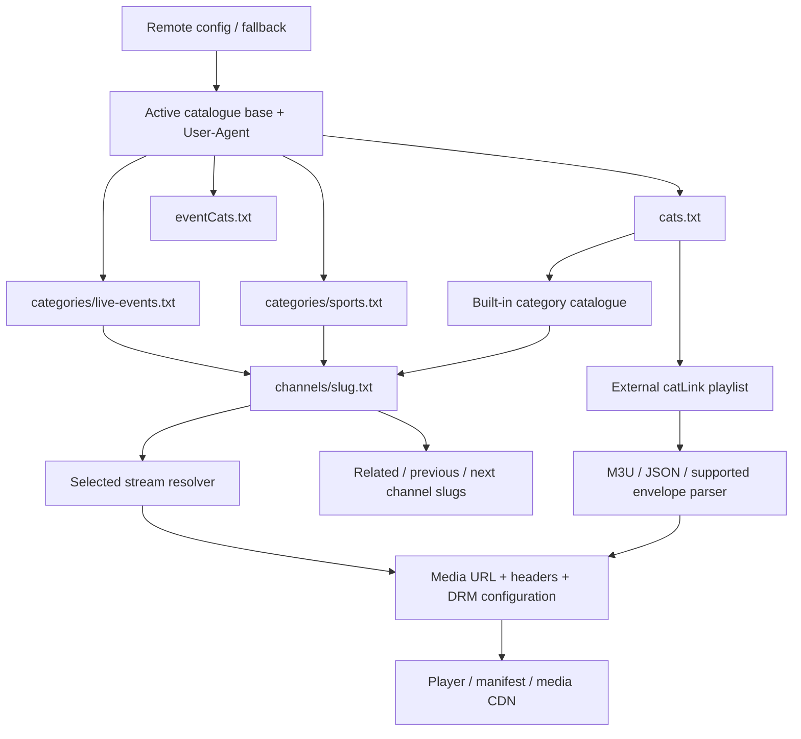

# Cricfy TV 7.3: backend contract and NikTv parity audit

Audit date: **28 October 2026**, America/Toronto. Reference: installed Samsung application `com.cricfytv.sports`, version **7.3 / 53**, model **SM-S948W**. NikTv source baseline: **91d27511**, `main`.

## Findings

NikTv has the Live Events catalogue, source selection, resolution and shared sports player. It does **not** yet offer Cricfy's independent Sports channel directory or Categories/playlist browsing. Live Events also has metadata and presentation gaps.

The current backend inventory contains:

| Resource | Observed result |
| --- | --- |
| Live Events | 45 event records |
| Sports tab | 57 channel titles, 164 source choices |
| Categories | 74 entries: 11 built-in collections and 63 external playlist destinations |
| All built-in collections | 148 channel records across the 11 collections |
| Channel/event detail documents | 193 fetched and decoded successfully |
| Detail source choices | 636: 463 type 0 and 173 type 7 |
| Event detail choices alone | 157: 111 type 0 and 46 type 7 |
| External playlist probes | 18 nonempty M3U responses, 5,667 entries before cross-provider deduplication |

These are time-specific metadata counts. Successful metadata requests do not establish that every stream plays. Only Willow's first source was visibly played in Cricfy during this audit.

The complete category inventory is in [the CSV](cricfy-tv-category-inventory-2026-10-28.csv). [The JSON inventory](cricfy-tv-backend-inventory-2026-10-28.json) also contains all 193 titles/slugs, category membership, source labels/counts/types, related-channel counts, next/previous availability and the 14 event filters. It deliberately omits stream URLs, provider tokens, cookies and licence values.

## Evidence and method

- Inspected all three tabs on the connected Samsung through normal app navigation; opened a Sports source chooser/player, a built-in Movies collection, an external SAMSUNG TV playlist, drawer, custom playlist import menu and channel favourite confirmation.
- Read the existing NikTv implementation and the previous Cricfy 7.3 APK analysis under `D:/workspace/artifacts/cricfy-73-audit/repaired-jadx/sources`.
- Pulled the installed APK and confirmed its SHA-256 matches `D:/workspace/android/CRICFy_v7.3.apk`: `d5b7a8cf16a9966a58d25841b1a108b7dba445fcd409ee932933b98f81d2de0d`.
- Fetched the public config, category/filter indexes, all 11 built-in collection files, all 193 channel/event detail files, and each of the 63 external playlist destinations. Catalogue decoding reused the existing local decoder. External responses were bounded to 2 MiB, with no follow-up media requests.
- Screenshots, successful hierarchy dumps, raw responses, fetch hashes, summaries and audit scripts are outside Git at `D:/workspace/niktv-playback-tests/cricfy-audit-20261028/`.
- The XML dump for `08-live-events` is stale: Android's idle-state capture failed on the animated screen. Use screenshots `08`, `09`, and the settled `10` as Live Events evidence. Intermediate `11` and `19` filenames describe intended navigation; inspect their actual images. `19` shows the final Sports directory with playback stopped.
- No NikTv application code, installed app versions, favourites, playlist records, quality settings or permissions were changed. The favourite confirmation was dismissed. No claim of Fire TV/tablet parity or exhaustive playback testing is made.

This documents the **client-facing backend contract**. The upstream server's source code, database, stream acquisition process and hosting internals were not accessible. Endpoint behavior and APK code establish how the client obtains and uses data, not how the operator produces it.

## What the three tabs offer

### Live Events

Observed: a horizontal sport-icon selector with counts; All, Live, Recent and Upcoming status chips with counts; team badges and names; sport/competition branding; local start date/time; a countdown before the start and elapsed time for live events. The settled Live selection showed three live football events. Source labels/quality variants lead into the common player.

The server's `eventCats.txt` contains 14 filter definitions: All, Cricket, Football, Boxing, Basketball, Baseball, Orioles, Motorsport, KRK, Tennis, Rugby, Aussie Rules, American Football and Ice Hockey. Some labels are team-like rather than generic sports. Preserve the service's identities/order and account for filters with no matching current events instead of rebuilding the index solely from today's records.

NikTv already parses title, slug, teams, sport, competition, logo, start/end and source-label previews. It supports search, status/sport filtering, refresh, source selection and playback. Differences:

| Feature/data | NikTv baseline | Required parity work |
| --- | --- | --- |
| Server-defined sport filters and icons | Derived from current events; no `eventCats.txt` request | Fetch/store filter definitions and show counts |
| Team badges | `teamAFlag` / `teamBFlag` discarded | Preserve/render both badges with fallbacks |
| Event artwork | Logo parsed, but event card uses a generic cricket icon | Render service artwork and sport-appropriate fallback |
| Featured event | `isHot` discarded | Preserve flag; define highlighted display/order; none set in this snapshot |
| Competition/name | `eventType` falls back to `eventName` | Preserve both values when fidelity requires them |
| Recent status | Finished filter exists; default is Now & next | Match Recent semantics, labels/counts and ordering after confirming its time window |
| Countdown / elapsed clock | Static local schedule and status | Add countdown/elapsed display without refetching each second |
| Source preview | `formats` reduced to title strings | Retain `title`, `webLink`, `geo` and service order |
| Favourites | No sports-channel favourite model in this module | Add channel/event favourite identity and entry point |
| Detail navigation | Only `streamUrls` retained | Preserve related/previous/next data |

Relevant code: `SportsCatalogue.kt` (`events`, `streams`); `SportsBrowseUi.kt` (`SportsEventCard`, filter construction); `SportsRepository.kt` (`events`). NikTv's Finished status is not evidence that it matches Cricfy's Recent time-window policy. Card elapsed time is schedule-derived; no separate live-score API was observed for these cards.

### Sports

Observed: a four-column portrait logo grid of channel brands, including TNT Sports, beIN, Star Sports, Astro Cricket, T Sports, Willow, Fox Cricket, Sky Cricket, Sony Sports, FanCode, PTV, TSN, WWE and others. The full backend list has 57 titles. This is a persistent channel directory separate from scheduled matches.

Selecting Willow opened **Multiple Links Available**, with WILLOW - HD, INDIA IP, WILLOW - AQ and WILLOW EX. HD/AQ badges are derived display labels; the actual choices come from the detail document. Willow's slug is `willow-`: the trailing hyphen is part of its identifier.

The first source visibly played cricket footage. The player showed the four source chips, related-channel logos, cast/PiP/settings/audio/lock controls, fit/rewind/pause/forward/fullscreen controls and a seek bar. Control visibility was verified; cast handoff, PiP, seeking and settings changes were not exercised. Long-pressing the Willow tile opened an Add to favourites confirmation, which was dismissed.

NikTv's current next/previous and queue actions navigate **sources of the current event**. Cricfy's `prevChannel` / `nextChannel` and `related` point to **other channel slugs**. They are different operations and need separate state and actions.

### Categories

Observed: a searchable, refreshable grid of country, genre and provider tiles. There are two routes:

1. **Built-in collection:** use the category title to request `categories/<lowercase-title-with-spaces-replaced-by-hyphens>.txt`, then use channel slugs for detail requests.
2. **External playlist:** follow the category's network `catLink`; parse its playlist response into named/logo/grouped playable items. Do not synthesize a built-in endpoint for these entries.

The built-in collections and current channel counts are:

| Category | Count | Relative catalogue path |
| --- | ---: | --- |
| Sports | 57 | `categories/sports.txt` |
| India | 11 | `categories/india.txt` |
| News | 7 | `categories/news.txt` |
| Kolkata | 11 | `categories/kolkata.txt` |
| Discovery | 8 | `categories/discovery.txt` |
| Pakistan | 1 | `categories/pakistan.txt` |
| Bangla | 25 | `categories/bangla.txt` |
| Kids | 10 | `categories/kids.txt` |
| Musics | 4 | `categories/musics.txt` |
| ISLAMIC TV | 2 | `categories/islamic-tv.txt` |
| Movies | 12 | `categories/movies.txt` |

`catLink` is not consistently null for built-in categories: Kids uses `N`, ISLAMIC TV uses the literal string `null`, and Movies uses `ok`. Route on a valid network URL, not truthiness/nonempty text. The audit's exploratory `categories/tata-play.txt` request returned 404 because TATA PLAY is an external playlist route; it is not a missing built-in collection.

Movies opened a grid of linear channels such as HBO, Colors Cineplex, &pictures, Star Gold, Zee Cinema and Star Movies. Its presence does not imply an on-demand movie catalogue.

SAMSUNG TV opened a named channel grid including Korean TV, B4U Movies, Cricket Gold and news channels; its external response contained 162 entries. The APK playlist screen also supports a searchable group chooser, retained selected group, local channel-name search and playlist favourites. Group parsing was confirmed in code and multi-group responses; the Samsung playlist observed on-device did not expose a multi-group chooser.

## Backend flow

### Bootstrap and HTTP contract

NikTv's existing public fallback configuration URL is:

`https://pub-9610baca6bf84734bf9d40546dc754a6.r2.dev/config.txt`

The decoded response currently specifies `https://cftkhffmgf147.top/` for both `cric_api2` and `cric_api1`, with no conditions. Thus this snapshot has no independent secondary catalogue host. These values are service configuration, not permanent identifiers.

The APK has Firebase Remote Config plus fallback configuration handling. Relevant keys are `cric_api2`, `cric_api1`, `userAgent` and `r2_config_urls`. NikTv handles the public fallback's conditional/default forms and caches config for 15 minutes; it does not implement every part of Cricfy's Firebase bootstrap. No change to Google's private config service is required to add the missing catalogues.

Metadata GETs use the configured/default User-Agent. NikTv bounds catalogue responses to 4 MiB and retries configured bases with a forced config refresh. Preserve cancellation, error reporting and these bounds when broadening the repository. External hosts have separate response behavior and should not inherit arbitrary credentials from another host.

| Relative request | Purpose / decoded root |
| --- | --- |
| `eventCats.txt` | Event filter definitions, array |
| `cats.txt` | Category navigation, array |
| `categories/live-events.txt` | Scheduled events, array |
| `categories/sports.txt` | Sports channels, array |
| `categories/<category-key>.txt` | Other built-in channel collections, array |
| `channels/<slug-lowercase>.txt` | Channel/event detail, object |
| `app_new.txt` | App-level message/config request present in APK; not fetched in this audit |

Title, image, schedule, group and source information is remotely supplied; the client renders the metadata and asks the detail endpoint only when needed. Images reference third-party image hosts. No catalog pagination parameters were observed on the built-in file endpoints.

### Catalogue encoding

The `.txt` suffix does not mean the response is plain JSON. The sampled built-in files decoded with the existing catalogue decoder. NikTv's `SportsCatalogue.document` accepts JSON objects/arrays, a Base64 salted catalogue encoding and two legacy AES formats. This is catalogue serialization and is separate from media DRM/licensing.

Cricfy 7.3 calls native `Baker.merge` from its network converter. The same-version decompilation also recognizes a `code`/`msg` JSON response wrapper. Some decompiled methods contain errors, so their output is evidence of supported branches rather than an executable specification for every response. The successful 193-document audit confirms compatibility with the current built-in snapshot; new wrappers still need explicit error/unwrapping handling in NikTv.

### Data contracts to preserve

| Model | Fields and meaning |
| --- | --- |
| Category | `id`, `title`, `image`, optional `catLink`, `geo` |
| Event filter | `id`, `title`, `image` |
| Channel/event preview | `id`, `title`, `image`, `slug`, `cat`, `publish`, `geo`, `formats`, optional `eventInfo` |
| Format preview | `title`, `webLink`, `geo`; this is a preview, not an authoritative playback URL |
| Event info | `teamA`, `teamB`, `teamAFlag`, `teamBFlag`, `eventName`, `eventType`, `startTime`, `endTime`, `eventLogo`, `eventCat`, `isHot` |
| Detail | `streamUrls`, `related`, `prevChannel`, `nextChannel`; schema additionally permits `header`, `body`, `hash`, `cat`, `relatedPlaylist`, `geo` |
| Stream | `link`, optional `api`, numeric/string `type`, `title`, `headers`, `drmType`, `drmLicense`, `geo`; sampled responses also contain `id` and empty `webLink` |
| Playlist item | `name`, `groupTitle`, `logo`, `link`, `userAgent`, `referrer`, `origin`, `cookie`, `drmLicense`, `drmScheme`, local `id`, `isFav` |

Use a general channel model with nullable event info. Reusing `SportsCatalogue.events` to parse channel lists produces event records without schedules and loses channel-specific metadata. NikTv currently reduces detail to `List<SportsStream>`, discarding the surrounding object.

Every sampled detail contains `related`; 192 contain `prevChannel`, 190 contain `nextChannel`. Optional existence does not mean the value is nonempty. No sampled detail had `relatedPlaylist`, `header`, `body` or `hash`; retain these as optional schema-supported fields rather than claiming current usage.

Dates use `yyyy/MM/dd HH:mm:ss Z`. Interpret the offset before displaying local time. Slugs are opaque identifiers: lowercase as the client does, but retain hyphens/underscores and validate before building a path. Keep duplicate source occurrences distinct even when titles or IDs repeat; Willow's four stream rows all use the same sampled `id`.

One concrete preview/detail discrepancy was found: `new-zealand-vs-india` advertises 11 format choices in the event list but returns 10 stream rows in its detail document. Build the actual chooser from freshly loaded detail, not the preview's count or positional indexes.

Availability has several layers: category, preview/channel, format preview, detail and stream. NikTv currently filters event and stream `geo`, but drops format/detail/category metadata. Current sampled values were missing/empty or `ALL`; this does not exercise restricted-region behavior. A SIM/network/locale country hint is not proof of the server's IP-based location.

### Stream resolution and playback

Both sampled resolver types are already represented in NikTv:

| Type | Meaning in existing implementation | Current snapshot |
| --- | --- | ---: |
| 0 | Direct media URL; parse pipe-suffixed request/DRM options | 463 choices |
| 7 | Direct protected stream with supplied DRM configuration; existing resolver defaults to ClearKey using `api` when explicit DRM fields are absent | 173 choices |
| 1 / 3 | Provider-specific authorization | Not observed; NikTv deliberately returns an unsupported-authorization error |
| 2 | Token-service request followed by URL suffix assembly | Not observed; implemented branch |
| 4 | Web player resolution | Not observed; implemented branch |
| 5 | VK page/embed resolution | Not observed; implemented branch |
| 6 | API lookup using a channel identifier | Not observed; implemented branch |
| 8 | Page-provided HLS manifest field | Not observed; implemented branch |
| 9 | Server-key lookup and provider URL assembly | Not observed; implemented branch |

Implemented does not mean freshly verified for the absent types. Do not count types 1/3 as completed parity if they reappear.

The resolved result must carry the media URL, per-source headers and supplied DRM information into the player. URL decorations may carry User-Agent, Referer/Referrer, Origin, Cookie, Authorization or DRM options. Do not discard options when normalizing URLs. Use the existing sports resolver/player path; do not treat `formats[].title`, `api`, or the catalogue URL itself as the media URL.

NikTv already maps HLS/DASH, supports configured DRM schemes in `SportsPlayer`, exposes source queues and fallback/retry, and isolates sports playback settings from IPTV. This audit reviewed that code, but did not run a new NikTv playback regression. The next/previous channel pointers must not replace its source-switch actions.

### External playlists

External destinations include Workers endpoints, PHP services, GitHub raw files, Gists and Pastebin. Resolve the destination from refreshed `cats.txt`; do not copy current tokenized `catLink` values into source code.

The APK parser supports JSON arrays, JSON objects with a `channels` array, M3U text, a legacy encrypted playlist form and a `CFP1.` envelope handled by native `PlaylistCipher.open`. The latter is a separate format from catalogue decoding. No `CFP1.` response appeared in the PC-side external probes; the eight opaque responses have not been decoded or proven to be that format.

M3U behavior to preserve:

- `#EXTINF`: title, `tvg-logo`, `group-title`.
- `#EXTVLCOPT`-style `http-user-agent`, `http-referrer`, `http-origin`.
- `#EXTHTTP`: cookie metadata.
- `#KODIPROP`-style `inputstream.adaptive.license_type` / `license_key`.
- Playlist item order and duplicate entries; All plus distinct groups; channel/group search; favourite state.
- Per-item option reset between entries, so headers/licence information cannot leak from the previous item.

Observed external response classifications:

| Response | Count | Interpretation |
| --- | ---: | --- |
| Nonempty M3U | 18 | 5,667 entries total, including duplicates across services; metadata only |
| Empty M3U | 7 | Header/comment content, zero `#EXTINF` entries |
| HTML over HTTP 200 | 19 | Not a usable playlist in this probe; may reflect upstream/client/network behavior |
| Opaque/possibly legacy encrypted | 8 | Adapter/format work remains; no playback conclusion |
| JSON error object | 6 | Objects have error fields, not channel arrays |
| HTTP error | 5 | Two 403s and three 404s |

HTTP 200 alone must not become a success state. JSON shape, parsed item count, HTML/error detection and decoding result determine the UI state. Report an empty upstream collection separately from connection failure and unsupported format. Avoid caching an error page as a valid playlist. PC-side failures are not proof the same category fails on the Samsung, since client headers, routing, cache and network may differ.

WORLD TV 2 alone returned 3,974 M3U entries, so playlist parsing/search needs a bounded background path and virtualized lists. Keep loading demand-driven; catalogue browsing should not start media requests or decoders.

## Shared features beyond the tabs

The observed toolbar includes notifications/unread badge, favourites, refresh and local search. The drawer exposes Network Stream, Playlists, Cric Score, Foot Score, Floating Player, Enable Low Quality, Bandwidth sharing, Copyright, Telegram, Contact, Share and Update App.

Custom Playlists showed an empty saved list and an add menu with **Add URL** and **Select File**. The import form was not submitted. The APK Room schema stores built-in favourites by channel ID with a unique slug, custom playlists by title/path, playlist favourites by link, cached responses by query/path, and notifications with viewed state.

For complete product parity, track these alongside the three tabs:

| Feature | Assessment |
| --- | --- |
| Built-in and playlist favourites | Missing from NikTv's sports browsing domain; reuse shared UI patterns but preserve domain identities |
| URL/local-file playlist import | New source/parser/storage capability; NikTv's current profile types are Stalker and Xtream |
| Raw network stream entry | Drawer action observed; full input behavior not exercised |
| Scores | Drawer actions observed; APK WebFragment has a Cricbuzz default URL; precise routing/football destination not validated |
| Floating player / PiP / cast | Cricfy controls/actions observed; compare against NikTv's existing facilities in a later device pass |
| Low-quality preference | Drawer action observed; exact effect and persistence not toggled/validated |
| Announcements / notifications | Visible ticker and unread count; local notification schema confirmed; delivery backend not traced |
| Update / contact / share / copyright | Auxiliary app features; do not treat them as catalogue endpoints |
| Bandwidth sharing / advertising | Present in Cricfy; separate monetization behavior, unnecessary to render titles or play sources; no settings changed |

## Port plan and acceptance criteria

1. **General catalogue contracts.** Add category, event-filter, channel-preview, detail and format models. Preserve optional fields instead of stripping them. Keep current event parsing, cancellation and regional behavior covered.
2. **Repository routes.** Add category index, event-filter index, built-in category list and full detail APIs beside the existing `events`/`streams` methods. Scope caches by base, country and path. Retain valid cached data on transient refresh errors and reject stale selection results.
3. **Three browse destinations.** Keep the existing NikTv Sports entry point, add Live Events / Sports / Categories destinations, remember selected tab/query/scroll/focus and restore the origin after source/player navigation. Add channel logos with readable text labels and touch/remote focus support.
4. **Detail and channel navigation.** Reuse `SportsStreamResolver` and the isolated sports player for selected sources; add separate channel next/previous and related-channel browsing. Fetch fresh details when appropriate; source preview counts are not authoritative.
5. **External source adapter.** Load `catLink` on demand, classify response bodies and support ordinary M3U and JSON channel collections with headers/DRM metadata. Handle empty/error/HTML bodies explicitly. Track legacy/CFP1 compatibility as separate work until verified with appropriate fixtures and actual supported responses.
6. **Persistence and Live Events fidelity.** Add built-in/playlist favourites, custom URL/file playlists, searchable groups, team artwork, count badges, countdown/elapsed clocks and optional featured metadata. Match Recent's exact policy after an additional targeted behavior/code check.
7. **Regression/acceptance.** Exercise each routing/format branch, malformed/large/empty responses, expired stream metadata, unavailable source fallback, geo layers, duplicate choices, next/previous channel versus source, cache refresh, and back/focus restoration. Validate phone, tablet and Fire TV, keeping IPTV playback/settings isolated.

Completion requires separate results for (a) backend contract parsing, (b) visible feature parity, and (c) playback of representative authorized sources. A provider failure should remain an actionable upstream error; it should not hide a category or be reported as a completed playable service. Existing NikTv engine/gesture/PiP behavior should be regression-tested rather than reimplemented from the Cricfy APK.

## Reproduction and evidence map

External evidence root: `D:/workspace/niktv-playback-tests/cricfy-audit-20261028/`.

| Evidence | What it establishes |
| --- | --- |
| `01-initial.png`, `06-categories-lower.png`, `14-categories-top.png` | Category presentation and provider variety |
| `02-sports.png`, `03-willow.png` | Channel directory and four-source chooser |
| `04-willow-player.png` | Actual visible playback, source chips, related channels, controls |
| `07-movies.png` | Movies is a linear-channel collection |
| `08-live-events.png`, `10-live-filter-settled.png` | Event metadata, count badges, countdown and live status |
| `13-samsung-playlist.png` | External playlist rendered as channel titles |
| `15-drawer.png`, `16-custom-playlists.png`, `17-add-playlist.png` | Auxiliary features and URL/file import choices |
| `18-channel-longpress.png` | Favourite action/confirmation; not submitted |
| `native-metadata-audit.json`, `remaining-channel-audit.json` | Fetch/decode status of built-in resources |
| `channel-summary.json`, `external-metadata-audit.json`, `format-mismatches.json` | Counts, format classifications and preview/detail differences |
| `fetch_catalogues.py`, `audit_external.py`, `build_inventory.py` | Audit collection and sanitized inventory generation |

Static evidence paths below are relative to `D:/workspace/artifacts/cricfy-73-audit/repaired-jadx/sources/`:

- `defpackage/z80.java`: `cats.txt`, `eventCats.txt`, `categories/live-events.txt`, `categories/sports.txt`, `app_new.txt`.
- `defpackage/g04.java`: built-in category title-to-path mapping.
- `defpackage/tu.java`: channel slug detail request.
- `defpackage/ct.java`, `ou.java`, `k11.java`, `rp1.java`, `cv.java`, `gi3.java`: category/channel/format/event/detail/stream serialization contracts.
- `defpackage/d14.java`, `a14.java`: playlist loading/filter state and content parsing; some decompiler errors remain.
- `defpackage/x71.java`, `com/android/vending/networking/Baker.java`, `PlaylistCipher.java`: response conversion and native envelope interfaces.
- `com/android/vending/fragments/PlaylistFragment.java`, `PlaylistsFragment.java`: group chooser and custom playlist UI.
- `defpackage/cb2.java`: Room table definitions for favourites, cache, playlists, playlist favourites and notifications.

No application implementation, build, install, commit or push was performed for this documentation task.
